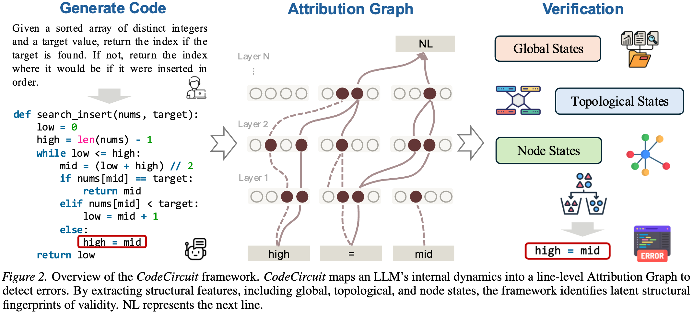

# CodeCircuit 🔍

### Toward Inferring LLM-Generated Code Correctness via Attribution Graphs

> This paper conducts an in-depth investigation into a central question: ​**can code generated by LLMs be evaluated for correctness *without* relying on external assistance**​?

> Inspired by mechanistic interpretability, we conduct a series of investigations. **Our key contribution is the demonstration that internal computational structures of LLMs—neural circuits—can serve as indicators of the correctness of generated code.**

> We explore a new avenue for verification and aim to provide insights that may inspire future work, with neural circuits emerging as a direction worthy of attention.

---

# Abstract

Current paradigms for code verification rely heavily on external mechanisms—such as execution-based unit tests or auxiliary LLM judges—which are often labor-intensive or limited by the judging model's own capabilities. This raises a fundamental, yet unexplored question: Can an LLM's functional correctness be assessed purely from its internal computational structure? Our primary objective is to investigate whether the model’s neural dynamics encode internally decodable signals that are predictive of logical validity during code generation. Inspired by mechanistic interpretability, we propose to treat code verification as a mechanistic diagnostic task, mapping the model's explicit algorithmic trajectory into line-level attribution graphs. By decomposing complex residual flows, we aim to identify the structural signatures that distinguish sound reasoning from logical failure within the model’s internal circuits. Analysis across Python, C++, and Java confirms that intrinsic correctness signals are robust across diverse syntaxes. Topological features from these internal graphs predict correctness more reliably than surface heuristics and enable targeted causal interventions to fix erroneous logic. These findings establish internal introspection as a decodable property for verifying generated code.

<p align="center">
    
</p>


# Requirements


Our code is based on [circuit_tracer](https://github.com/safety-research/circuit-tracer). So you just need to install requirements based on [circuit_tracer](https://github.com/safety-research/circuit-tracer). And some extracted feature functions are similar to [CRV](https://github.com/facebookresearch/CRV/blob/main/features/feature_extraction.py)


# Run CodeCircuit 🚀
Our codebase is clearly structured. Under the `data/` directory, the scripts can be executed sequentially in order from 0 to 5.
```
python 0_generate_response.py  # generate code from LLMs
```
Simply run the scripts in order using `python x.py`.

# Replication log (this fork)

This fork replicates CodeCircuit on Python as a baseline for extending the study
to Rust. Phase 1 — reproducing the reported Python AUROC — completed on
2026-09-16.

| Split | AUROC | vs. paper (79.89%) |
|---|---|---|
| Ordered 70/30, as in `5_classification.py` | **79.73%** | −0.16 pt |
| `GroupShuffleSplit` by `expr_id`, 20 seeds | 77.06% ± 4.25% | −2.83 pt |

Both numbers come from the same 1420-graph dataset (248 label-0, 1172 label-1,
256 problems; no graph failed or was skipped).

**The ± above is not a confidence interval, and neither is any other ± in the
literature this replicates.** Twenty `GroupShuffleSplit` seeds reshuffle splits
of the *same* 256 problems, so the spread measures split noise, not sampling
error. Resampling the 256 problems instead gives intervals 4–10× wider. Every
interval below is a cluster bootstrap over problems. For the same reason, a
paired t or Wilcoxon over seeds is not a hypothesis test: its p-value is a
function of how many seeds you draw — one comparison here gives p = 0.2305 at 20
seeds, 0.0494 at 50, 0.0010 at 100.

**Two corrections to earlier versions of this section.** First, the gap between
the two splits was described here as train/test leakage. It is not. Exactly 1 of
256 problems straddles the positional boundary (task 392, 1 row in train and 13
in test = 3.0% of ordered test rows), and a task-identity oracle scores AUROC
0.4933 on that split — chance. The gap is which problems landed in test. (The
straddle is a real if minor defect in the paper's protocol, so the ordered
numbers should be read as confirmed by the grouped ones rather than standalone.)

Second, this section previously argued that re-labelling against execution
"drops" AUROC from 0.7973 to 0.6068 and that this indicts the paper. That
framing was wrong twice over. The execution labels had a bug of my own (below),
and the comparison was made at row level against a task-constant label, which
weights each problem by its solution length — and length correlates with the
label. Corrected and measured at the problem level, the paper's central claim
survives; its headline magnitude and its reported precision do not.

## What the 79.73% measures

The labels are not execution results. `1_code_correct.py` asks gpt-4o-mini to
score each generated line 1 or 0, and its prompt *mandates* the shape the labels
come out in:

> Once a line violates the requirements, all following lines must also be 0.

So the label is not an emergent judgment about each line. It is one cutoff index
per problem, by construction. What follows is measured on this dataset:

- **256 integers reproduce the whole label set.** 255 of 256 problems have
  monotone non-increasing scores (the exception is task 172, `[1,1,1,0,1,1]`).
  Predicting "1 iff `step_number` < cutoff" reconstructs 1418 of 1420 row labels
  — 99.86%. The 1420-row vector carries at most 625.25 bits (Σ log₂(nᵢ+1)).
- **Effective sample size is 256 problems.** ICC of the judge label is 0.4976
  (n_eff ≈ 435 rows); for a task-constant execution label ICC is 1 by
  construction and n_eff is exactly 256. This does not move the point estimate —
  it inflates precision, by 1.95× on identical predictions.
- **A second prompt rule explains the judge's blind spot.** Rule 4 tells it to
  ignore "parameter variable names, function names, and so on". MBPP never states
  the required function name, so 210 of 256 generations fail execution on
  `NameError` — the one failure mode the judge is instructed not to look at.
- **The signal is between problems, not within them.** Only ~1% of (positive,
  negative) test pairs are within-task, and deleting every within-task comparison
  moves the row-level judge AUROC by −0.0010. The within-task signal that does
  exist is positional: untrained `-step_number` scores 0.9976 on same-task pairs
  against 0.8850 for the trained 49-dim model. This dataset cannot evidence
  line-level error localisation for any method, in either direction.

## Against execution instead

MBPP ships tests. Running the 256 generations against them (subprocess, 10 s
timeout) re-labels the *same* graphs — only `y` changes, so the 5 days of graph
compute is reused.

**A bug of mine, found independently by two analysts.** My first execution labels
never ran MBPP's `test_imports`, so the 13 problems whose asserts call
`math.isclose` failed spuriously. The aliasing rule, stated in full because an
earlier version of it was not: take the first `Call` in the assert whose func is
a bare `Name`, in source order, preferring a name not in `builtins`; if every
candidate is a builtin take the first anyway (task 126 genuinely tests a function
named `sum` — this fallback fires exactly once, and it is the whole 113-vs-114
discrepancy between two independent reimplementations); if the generation defines
exactly one top-level function under a different name, bind the target to it.

| Target | pass rate | problem-level AUROC | 95% CI (bootstrap over problems) |
|---|---|---|---|
| Execution, name-adapted | 114/256 (44.5%) | **0.7324** | [0.6703, 0.7918] |
| Execution, strict | 15/256 (5.9%) | 0.6234 | [0.4445, 0.7919] |

The paper's 79.89% lies outside that interval. Strict execution is unusable as a
target: 15 positives, and an interval that includes chance.

Judge and execution disagree on 47% of rows, one-directionally — **69 problems
where the judge passes a failing solution against 6 the other way** (κ = 0.44).
Of those 69, 58% return a wrong value of the right type and only 6 pass the first
assert and fail a later one: they are wrong algorithms, not edge cases. The 6 in
the other direction are all working code that diverged from MBPP's idiom
(`int(a/b)` where the reference uses `//`, a comprehension where it uses `map`).

One caution on the sensitivity analysis: AUROC across eight execution-label
variants is perfectly rank-ordered by positive rate (Spearman = 1.00, n = 8), so
label-definition effects and base-rate effects cannot be separated here.

## What survives, and what does not

**Survives — the paper's comparative claim.** At the problem level against
corrected execution labels, the graph features beat surface heuristics by a
margin whose bootstrap CI excludes zero. Four independent implementations agree
on the direction and roughly on the size:

| Comparison | Δ AUROC | 95% CI |
|---|---|---|
| 49 graph dims vs trained RF on 14 surface features | +0.1519 | [+0.0737, +0.2302] |
| 49 graph dims vs `-n_steps` | +0.1310 | [+0.0641, +0.1988] |
| 49 graph dims vs `-len(generated_code)` | +0.1032 | [+0.0384, +0.1669] |

This margin is the number that reverses if you score at row level, because a
row-level AUROC against a task-constant label weights each problem by its
solution length, and length correlates with the label. Measured at row level the
same comparison looks like a tie; that appearance is a metric artefact.

**Survives — the features are not a size proxy.** Ten of the 49 dimensions
correlate |r| > 0.7 with prefix length, `total_active_features` reaching 0.974.
Dropping all ten costs 0.009 (0.7324 → 0.7232 [0.6604, 0.7820]). That most
length-correlated dimension, used alone, scores 0.5329 [0.4590, 0.6036] — chance.

**Does not survive — the magnitude.** 0.7973 is a row-level score against a
prompt-mandated step function. The comparable quantity is 0.7324 [0.6703, 0.7918].

**Does not survive — the reported precision.** See the note on ± above.

**Open, and the most interesting thing here.** The dimensions carrying the
execution signal are not the ones carrying the judge signal: Spearman between the
two permutation-importance vectors is 0.031, sharing 2 of 10 top dimensions.

## Known defects in this dataset

- **16 of 256 generations carry markdown fences.** `generated_code` contains
  literal ``` fences and, in several cases, the same functions repeated several
  times — an extraction bug upstream of everything here, not a model failure.
  They account for 242 of 1420 rows (17%), and the judge scored every line 1 on
  6 of them, including the bare fence line, against its own rule 1. Predicting
  "does this parse" from the graph features scores **0.9995** [0.9975, 1.0000]
  at problem level: these features separate sharply when the target is an
  extraction artefact, and weakly when it is correctness.
- **The `len(text) > 550` filter is class-biased.** 27 of 1447 rows dropped, 67%
  of them label 0 against a 17.5% base rate. Six of the eight affected problems
  are the fence-corrupted ones.
- **The study is data-starved.** The learning curve is still rising at the
  largest training set available: 51 problems → 0.663, 102 → 0.715, 153 → 0.733,
  204 → 0.752. 256 problems does not saturate this question.
- **Three of the 49 features are constant** — `n_connected_components` (always 1)
  and both shortest-path dimensions, stuck at their −1.0 sentinel because
  `adjacency_matrix` never populates input-token rows. The effective feature
  space is 46-dimensional.

**`BATCH_SIZE` is not a performance knob**, which matters before comparing across
languages. `attribute()` chooses which `MAX_FEATURE_NODES` of the active features
enter the graph by greedy frontier expansion, re-ranking once per
`update_interval * batch_size` features, so it changes the graph itself. The cap
binds on **all 1420 graphs** — active feature counts run 16,785 to 216,132
(p5–p95: 27k–152k), so 8192 is between 3.8% and 48.8% of what was available, and
never more than all of it. All 1420 graphs were generated at the upstream default
of 64, and the Rust arm must use the same value.

## Plan for the Rust arm

The Python arm's real finding is not "the paper is wrong" — its comparative claim
held up under adversarial checking. It is that the reported quantity is measured
at the wrong unit, against a target whose shape a prompt dictates, with intervals
that understate uncertainty several-fold. The Rust arm is worth running as the
same question asked properly, and it must not repeat any of this.

1. **Fix the extraction before generating anything — done.**
   `0_generate_responses.py` now treats fences as separators rather than
   delimiters (pairing is what broke: the model emits ``` immediately followed
   by ```python, and a paired regex reads the second as the first's closing
   fence and drops everything outside), de-duplicates repeated blocks, drops a
   block that a later one restarts, and preserves indentation so a fence that
   splits a `def` from its body rejoins. It then refuses to finish quietly:
   every generation is `ast.parse`-checked and the failures are listed. Applied
   to the shipped Python generations the new extractor repairs **16 of 16** and
   changes none of the 240 that already parsed — parse rate 240/256 → 256/256.
   The same fix went into the Java script; the C++ script already had a working
   version further down the file, shadowing the broken one, which is where all
   three copies most likely came from. That dead copy is deleted.
   The existing Python graphs were built on the corrupted prefixes and cannot be
   repaired without regenerating, but the headline does not depend on them:
   dropping all 16 problems gives 0.7111 [0.6431, 0.7755] against 0.7324
   [0.6686, 0.7955] on all 256.
2. **Put the required signature in the generation prompt.** MBPP does not state
   the function name, which cost 210 of 256 Python generations a `NameError`
   before any assert ran. Ported naively that becomes a Rust compile error, and
   the label measures naming rather than reasoning.
3. **Label with `cargo test`, not an LLM judge**, and re-label the Python arm the
   same way so the two are the same quantity. Graphs are label-independent, so
   each re-labelling costs seconds rather than another 5-day run.
4. **Evaluate at the problem level, with a bootstrap over problems.** Execution
   labels are constant within a problem, so a row-level AUROC weights problems by
   solution length and a seed-to-seed sd measures split noise rather than
   sampling error. Score one aggregated prediction per held-out problem and
   resample problems for every interval. Do not report a paired t or Wilcoxon
   over splits: its p-value is a function of the seed count, not of the evidence.
5. **Pre-register the comparison as 0.7324, 95% CI [0.6703, 0.7918].** That is
   Python at the problem level against corrected execution truth. Comparing Rust
   to 79.89% compares two different quantities measured two different ways.
6. **Use more than 256 problems.** The Python learning curve is still rising at
   204 training problems, and the interval on any single label definition is
   ±0.06. At this n, a Python-vs-Rust difference smaller than about 0.10 is not
   resolvable, so a null result would be uninformative rather than interesting.
7. **Match the length filter on tokens or on drop rate**, and report the dropped
   count and class balance per language. A fixed character threshold will cut a
   different share of a more verbose language.

## Phase 2: the Rust arm

Generation and labelling are done; no graphs have been built yet. Nothing here
costs GPU time, and the point of doing it first was to find out whether the arm
is viable before committing any.

**How much of MBPP can be ported.** `data/mbpp_rust.py` reads a Rust signature
off the literals in each task's asserts, requiring the types to agree across
every assert and rejecting the task rather than guessing when they do not.
**350 of 427 tasks survive (82.0%)**; of the Python arm's 256, 207 do. The
rejects are 31 whose argument types disagree between asserts, 18 with an
argument type that has no simple Rust form (empty list literals, dicts, None),
13 with disagreeing return types, 10 with an unrepresentable return, and 5 with
a non-literal argument. Returns are 153 `i64`, 55 `bool`, 40 `Vec<i64>`, 34
`String`, 21 `f64` and a tail of tuples; 237 of the 350 take one argument.

**Labels come from `rustc`, not a judge.** `data/1_rust_correct.py` compiles each
generation, renames any `main` the model wrote, evaluates every assert inside
`catch_unwind` so a panic in case 2 cannot hide that case 1 passed, and runs
under a wall-clock timeout. Float asserts use MBPP's own `rel_tol=0.001`. It is
checked against eight hand-written solutions whose outcomes were stated in
advance — correct, wrong answer, syntax error, type error, panic, infinite loop,
a solution defining its own `main`, one defining a helper — and classifies all
eight as specified.

| | Rust | Python (same protocol) |
|---|---|---|
| compiles / parses | 214/350 (61.1%) | 256/256 after the extraction fix |
| passes every assert | **99/350 (28.3%)** | 114/256 (44.5%) |
| passes, given it compiles | 99/214 (46.3%) | — |

On the 207 problems both arms cover: Python passes 97 (46.9%), Rust 55 (26.6%);
51 pass in both, 106 in neither, 46 in Python only and **4 in Rust only**. The
model is much weaker in Rust, which is the finding the arm exists to exploit —
but it also means the two arms are not matched on difficulty, and that has to be
carried into any comparison.

**Two pipeline artefacts, found before spending GPU time.** The Python arm's
lesson applied: check whether a failure class is the model's fault or the
harness's. 14 generations began with a stray `;` — the model terminating the
dangling signature the prompt ends on — and 9 ended with unbalanced braces
because the model finished the function, started rewriting it, and hit the token
cap. Both are the harness's fault. Removing them gained **+10 compiles and +3
passes with zero regressions**. An A/B over three prompt endings on 40 problems
found no pass-rate difference between the bare signature and a wordier version
that never provokes the `;` (15/40 vs 13/40), and opening the body for the model
was much worse (5/40), so the prompt stands and the artefacts are cleaned.

**The length filter is matched on drop rate, not on the threshold.** Python drops
27 of 1447 rows (1.87%) at 550 characters. **`MAX_PROMPT_CHARS=605` drops 38 of
2031 Rust rows (1.87%)** — the same rate. `3_generate_graph.py` now reads that
threshold from the environment and still defaults to 550, so the Python numbers
are unchanged. Note the filter is class-biased in both arms and in opposite
directions: the rows it removes are 33.3% positive in Python against an 81.6%
base rate, and 0.0% positive in Rust against 37.7%.

**What the graphs will cost.** 1993 Rust rows survive the filter against 1420
Python rows — 1.40x by row count, but **1.92x by token sum**, and cost is
superlinear because peak allocation crosses the 12 GB card around 130-140 tokens
and spills to host RAM over PCIe. Rows past that knee: **259 in Rust (13.0%)
against 83 in Python (5.8%)**. Extrapolating from a benchmark was wrong by 2.8x
last time, so the estimate is being measured instead, on a 12-row sample
stratified over the token range (27-284) in the production code path.

Note for anyone forking this: `data/1_code_correct.py` carries a hardcoded
OpenAI key inherited from upstream. It must not be used, and must be scrubbed
from history before this fork is ever made public.

Generation took 5 days 10 hours on one RTX 5070 (12GB) at
`batch_size=64, offload='cpu'`, chunked at 200 graphs so peak disk stays near
80GB rather than the ~500GB a whole language would otherwise need. See
`data/run_chunked.sh`.

# Baselines
To help you reproduce our results more conveniently, here is the repository for the baseline: [Fair-mir](https://github.com/ncancedda/Chain-of-Embedding/tree/fair-mir).

# Citation

If you find our works helpful, please cite

```bibtex
@misc{he2026codecircuit,
      title={CodeCircuit: Toward Inferring LLM-Generated Code Correctness via Attribution Graphs}, 
      author={Yicheng He and Zheng Zhao and Zhou Kaiyu and Bryan Dai and Jie Fu and Yonghui Yang},
      year={2026},
      eprint={2602.07080},
      archivePrefix={arXiv},
      primaryClass={cs.SE},
      url={https://arxiv.org/abs/2602.07080}, 
}
```
If you have any questiones. Feel free to reach out!
